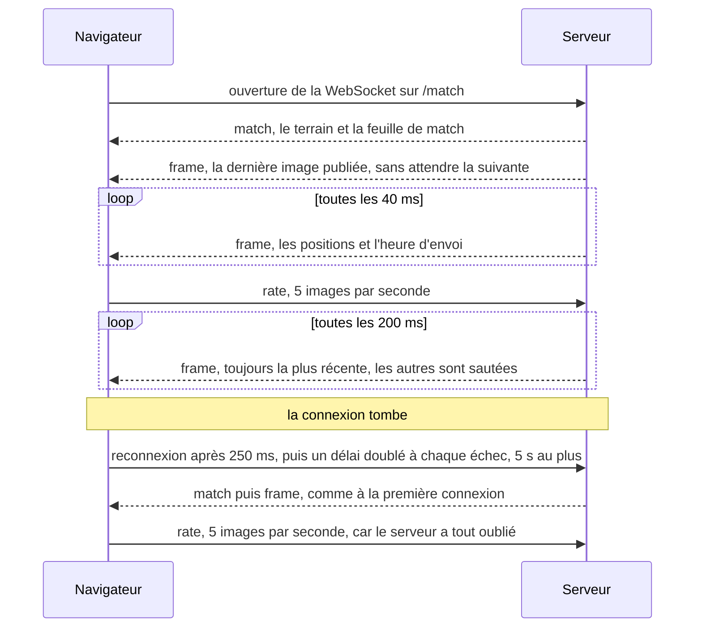
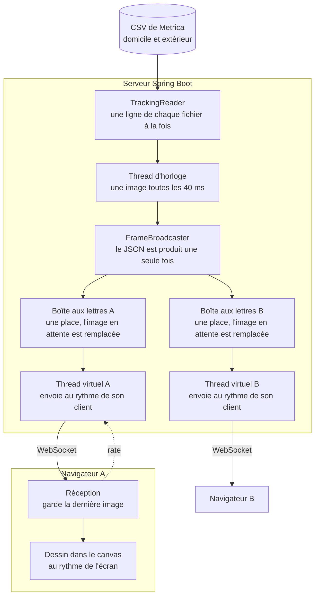

# pitch-live

Rejoue un vrai match de football à 25 images par seconde depuis un serveur Java (Spring Boot), le diffuse en WebSocket et l'affiche en 2D dans le navigateur. La conception est décrite dans [docs/conception.md](docs/conception.md).

## Prérequis

- JDK 25 (`brew install --cask temurin@25`)
- [Bun](https://bun.sh)
- make

## Lancer le projet

```bash
make data     # télécharge les données du match 1 dans data/
make server   # serveur sur http://localhost:8080
make client   # client sur http://localhost:5173
make test     # tests du serveur et vérification des types du client
```

Le serveur et le client se lancent chacun dans son terminal.

## Les échanges entre le serveur et le navigateur

Trois messages en JSON, chacun avec sa version (`v`). Le contrat est décrit en miroir dans [Protocol.java](server/src/main/java/dev/baptiste/pitch_live/Protocol.java) et [protocol.ts](client/src/protocol.ts).

| Message | Sens | Quand | Contenu |
| --- | --- | --- | --- |
| `match` | serveur vers navigateur | une fois, à la connexion | les dimensions du terrain et les 28 joueurs (identifiant, équipe, numéro) |
| `frame` | serveur vers navigateur | à chaque image | numéro, période, temps de jeu, joueurs présents (identifiant et position en mètres), ballon ou `null`, heure d'envoi `sentAt` |
| `rate` | navigateur vers serveur | quand l'analyste change de fréquence | le nombre d'images par seconde voulu, de 1 à 25 |



## À l'intérieur

Côté serveur, un client lent ne ralentit personne : l'horloge dépose chaque image dans la boîte aux lettres de chaque client sans jamais attendre, et chaque client a son propre thread d'envoi. Côté navigateur, la réception et le dessin sont séparés : la réception garde la dernière image, le dessin la relit au rythme de l'écran.



## Les données

Les données de suivi viennent des [données d'exemple de Metrica Sports](https://github.com/metrica-sports/sample-data) : des matchs réels et anonymisés, avec la position de chaque joueur et du ballon 25 fois par seconde. Elles ne sont pas versionnées dans ce dépôt, `make data` les télécharge.
