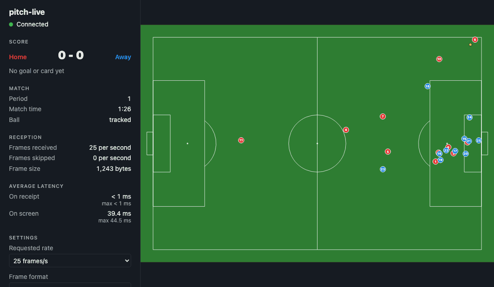
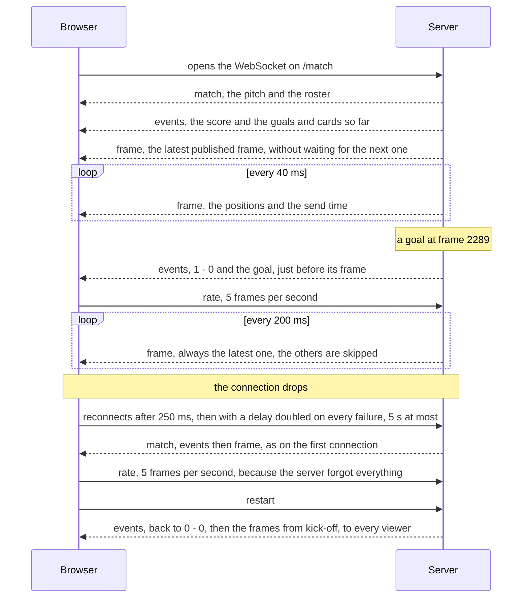
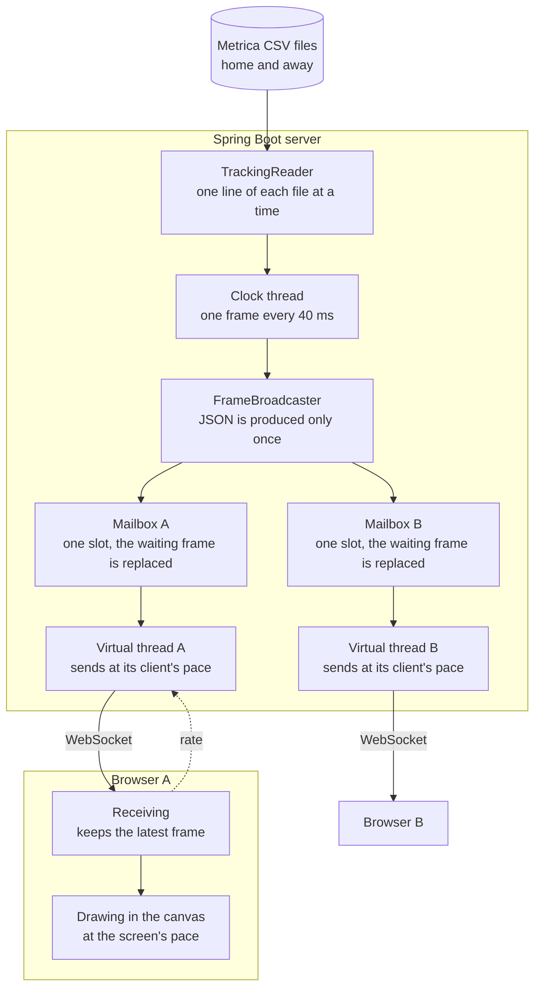

<div align="center">
  
  <h1>Pitch Live</h1>
  <p>
    <strong>A football match, live in your browser.</strong><br>
    A Java server replays real tracking data at 25 frames per second and streams it over WebSocket; the browser draws every player and the ball in 2D.
  </p>
  <p>
    <a href="#features">Features</a>
    ·
    <a href="#getting-started">Getting started</a>
    ·
    <a href="#how-it-works">How it works</a>
    ·
    <a href="#roadmap">Roadmap</a>
  </p>
  <p>
    
    
    
    
    
  </p>
</div>



<p align="center"><em>Match 1 from 1:26 to 1:36 on the match clock, with smoothing on: the home team's #9 (red) scores a header, and the score and the event log update in the panel.</em></p>

## Features

- **Live replay at 25 frames per second**: a real match from Metrica Sports' open tracking data, every player and the ball, in metres.
- **One shared broadcast**: every viewer watches the same stream, sees the whole pitch at once when joining mid-match, and anyone can restart from kick-off for everyone.
- **Live score**: goals and cards appear as they happen, and a viewer who skipped frames or joined late still gets every goal.
- **A rate per viewer**: each client asks for 1 to 25 frames per second, and a slow client never holds the others back.
- **JSON or binary frames**, chosen by each client: 1,240 bytes in JSON, 135 in binary.
- **Smooth movement**: optional interpolation between the last two frames, at the cost of one frame of delay.
- **Live metrics**: frames received and skipped, frame size, latency on receipt and age of what is on screen.
- **Slow client simulation**: 60 ms of work per frame, more than the 40 ms between frames, to see what happens when the browser cannot keep up.
- **Automatic reconnection**, with a delay doubled on every failure, 5 s at most.

## Tech stack

| Area | Tools |
| --- | --- |
| Server | [Java 25](https://openjdk.org), [Spring Boot](https://spring.io/projects/spring-boot) 4.1, raw WebSocket, virtual threads |
| Client | [TypeScript](https://www.typescriptlang.org), Canvas 2D, no framework |
| Build | [Maven](https://maven.apache.org) wrapper, [Vite](https://vite.dev), [Bun](https://bun.sh), make |
| Tests | JUnit, TypeScript type check |
| Data | [Metrica Sports sample data](https://github.com/metrica-sports/sample-data) |

## Getting started

Requirements: JDK 25 (for example [Temurin](https://adoptium.net)), [Bun](https://bun.sh) and make.

1. Start the server, which downloads match 1 into `data/` the first time:

    ```sh
    make server
    ```

    It listens on port 8080, with the WebSocket endpoint on `/match`.

2. In another terminal, start the client:

    ```sh
    make client
    ```

    It runs at [http://localhost:5173](http://localhost:5173).

3. Open it in two tabs, set one to 1 frame per second, and watch the other stay live. The first goal comes at 1:31.

To point the client at a server other than port 8080 of the machine, start it with `VITE_SERVER_URL=ws://host:port/match`. To receive binary frames, add `?format=binary` to the page address, or pick the format in the panel.

### Commands

| Command | Description |
| --- | --- |
| `make data` | Download match 1 from Metrica into `data/` |
| `make server` | Run the Spring Boot server on port 8080 |
| `make client` | Run the Vite client on port 5173 |
| `make test` | Run the server tests and type-check the client |

### The match

The teams and the competition of match 1 are unknown, on purpose: Metrica anonymised them. The data still tells the story: the home team (red) wins 3-0, with goals at 1:31, 60:00 and 66:01 on the panel's match time, which runs on without stopping at half-time.

## How it works

The design, its decisions and what the measurements taught are described in [docs/design.md](docs/design.md).

### Messages between the server and the browser

Five JSON messages, each carrying its version (`v`). The contract is mirrored in [Protocol.java](server/src/main/java/dev/baptiste/pitch_live/Protocol.java) and [protocol.ts](client/src/protocol.ts).

| Message | Direction | When | Content |
| --- | --- | --- | --- |
| `match` | server to browser | once, on connection | the pitch dimensions and the 28 players (id, team, shirt number) |
| `events` | server to browser | on connection, then whenever it changes | the score, and every goal and card so far |
| `frame` | server to browser | on every frame | frame number, period, match time, players on the pitch (id and position in metres), ball or `null`, send time `sentAt` |
| `rate` | browser to server | when the analyst changes the rate | the number of frames per second wanted, from 1 to 25 |
| `restart` | browser to server | when the analyst restarts the match | nothing else: the whole replay goes back to kick-off |

Goals and cards come from Metrica's event data, whose frame numbers are aligned with the tracking data: the clock releases each event at the frame where it happens. A frame is state, and losing one does not matter since a newer one follows; a goal is an event, and must never be lost. So the `events` message carries the whole log rather than the latest event: a client that skips frames, or joins late, still ends up with every goal.

A client connecting with `?format=binary` gets the presentation in JSON, then the frames in binary: 135 bytes instead of 1,240, with players referred to by their rank in the presentation. The byte-by-byte layout is described in [BinaryFrameEncoder.java](server/src/main/java/dev/baptiste/pitch_live/BinaryFrameEncoder.java).



### Inside

Server side, a slow client slows nobody down: the clock drops every frame into each client's mailbox without ever waiting, and every client has its own sender thread. Browser side, receiving and drawing are separate: receiving keeps the latest frame, drawing reads it again at the screen's pace.



### What the measurements show

Measured locally, over the first seconds of match 1. Even on one machine, the server's clock (the system clock, adjusted by NTP) and the browser's (anchored at page load, then monotonic) only agree to within about a millisecond: the panel shows "< 1 ms" below that, after once displaying -0.7 ms. Between two machines, the offset between their clocks would add up to the measurement.

| Measurement | Result |
| --- | --- |
| Frame size | 1,240 bytes in JSON, 135 in binary. On the wire, the permessage-deflate compression, negotiated by default, brings them down to about 176 and 126 bytes. |
| Latency on receipt | Under 2 ms at 25 frames per second. 11 to 27 ms when the client asks for fewer frames, while the frame waits in its mailbox. |
| Age of what is on screen | 20 ms on average at 25 frames per second (42 at most). 41 ms with smoothing, but steady. At 1 frame per second: 530 ms without smoothing, 1,010 ms with it. |
| Slow client | A delay that grows without bound: 32 s after 95 s, without the server skipping a single frame. At 10 frames per second, the same client keeps up. |

The last row is the most instructive. The one-slot mailbox protects against sends that block: a slow network, a client that stops reading. It does not protect against a page that is too slow to process what it receives, because frames first pile up in the OS and browser buffers, several megabytes, and the server feels nothing. The client must then ask for fewer frames itself, or the protocol needs flow control: the client acknowledges every frame, and the server never has more than one in flight towards it.

## Project structure

```text
server/src/main/java/dev/baptiste/pitch_live/
├── TrackingReader.java         Both tracking files side by side, converted to metres
├── EventReader.java            Goals and cards from the event file
├── MatchReplay.java            The clock: one frame every 40 ms, restart from kick-off
├── FrameBroadcaster.java       Fans every frame out to all connected clients
├── ClientConnection.java       A connected browser: its mailbox, rate and sender thread
├── BinaryFrameEncoder.java     The binary frame layout
├── MatchWebSocketHandler.java  The WebSocket endpoint
└── Protocol.java               The message contract
client/src/
├── connection.ts               WebSocket connection and reconnection
├── protocol.ts                 The message contract, mirrored from Protocol.java
├── render.ts                   The pitch, the players and the ball in a canvas
├── smoothing.ts                Interpolation between the last two frames
├── latency.ts                  Latency measurements
└── main.ts                     Receiving, drawing and the panel
docs/                           Design document and demo recording
scripts/                        Data download
```

## Roadmap

### Streaming

- **Flow control**: the client acknowledges every frame and the server never has more than one in flight towards it, so a slow page cannot pile up frames in its buffers.
- **Adaptive rate**: the client lowers its own rate when its latency on receipt climbs.
- **Protobuf frames**, with compression turned off for those clients, for when payloads grow.
- **Scale out**: a message bus between the replay and several WebSocket servers, each broadcasting to its own clients.
- **Several matches at once**, each with its own clock, presentation and latest frame.

### Analysis

- **Trajectories, zones and heatmaps** drawn on the pitch.
- **Rewind per viewer**, from a store of frames indexed by time, with the live edge served separately.
- **A live tracking source** instead of the CSV replay: only the reader changes, since the contract is in metres.

## Credits

- Tracking and event data from [Metrica Sports' sample data](https://github.com/metrica-sports/sample-data): real, anonymised matches, with the position of every player and of the ball 25 times per second, and the events of the match. They are not versioned in this repository; `make data` downloads them.
- Conversion to metres after [LaurieOnTracking](https://www.github.com/Friends-of-Tracking-Data-FoTD/LaurieOnTracking), by Laurie Shaw.

---

<p align="center">Made by <a href="https://baptistemiramont.fr">Baptiste Miramont</a></p>
