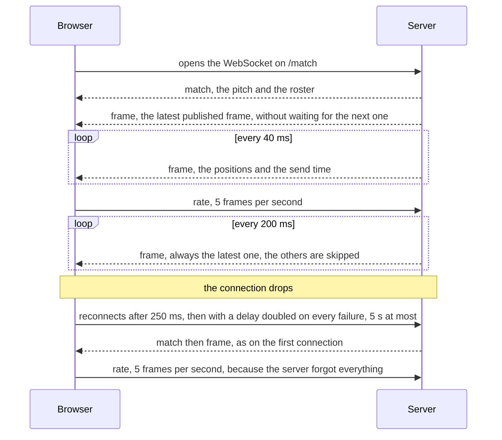
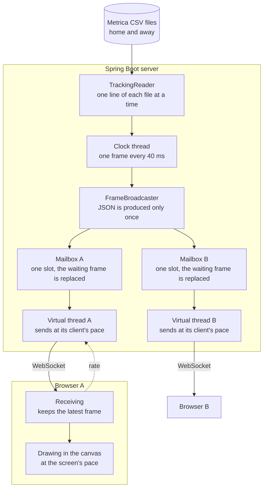

# pitch-live

Replays a real football match at 25 frames per second from a Java server (Spring Boot), broadcasts it over WebSocket and displays it in 2D in the browser. The design is described in [docs/design.md](docs/design.md).

## Requirements

- JDK 25 (`brew install --cask temurin@25`)
- [Bun](https://bun.sh)
- make

## Running the project

```bash
make data     # downloads match 1 into data/
make server   # server on http://localhost:8080
make client   # client on http://localhost:5173
make test     # server tests and client type check
```

The server and the client each run in their own terminal. To point the client at a server other than port 8080 of the machine, start it with `VITE_SERVER_URL=ws://host:port/match`.

In the page, the panel on the left shows the frames received and skipped, the average frame size and two latencies: on receipt, and the age of what is on screen. It also lets you:

- **request fewer frames** from the server, from 25 down to 1 per second: two tabs at different rates show that a slow client does not hold the other one back;
- **choose the frame format**, JSON or binary (`?format=binary` in the page address);
- **smooth the movement** between two frames, at the cost of one frame of delay;
- **simulate a slow client**: every frame keeps the page busy for 60 ms, more than the 40 ms between frames.

## Messages between the server and the browser

Three JSON messages, each carrying its version (`v`). The contract is mirrored in [Protocol.java](server/src/main/java/dev/baptiste/pitch_live/Protocol.java) and [protocol.ts](client/src/protocol.ts).

| Message | Direction | When | Content |
| --- | --- | --- | --- |
| `match` | server to browser | once, on connection | the pitch dimensions and the 28 players (id, team, shirt number) |
| `frame` | server to browser | on every frame | frame number, period, match time, players on the pitch (id and position in metres), ball or `null`, send time `sentAt` |
| `rate` | browser to server | when the analyst changes the rate | the number of frames per second wanted, from 1 to 25 |

A client connecting with `?format=binary` gets the presentation in JSON, then the frames in binary: 135 bytes instead of 1,240, with players referred to by their rank in the presentation. The byte-by-byte layout is described in [BinaryFrameEncoder.java](server/src/main/java/dev/baptiste/pitch_live/BinaryFrameEncoder.java).



## Inside

Server side, a slow client slows nobody down: the clock drops every frame into each client's mailbox without ever waiting, and every client has its own sender thread. Browser side, receiving and drawing are separate: receiving keeps the latest frame, drawing reads it again at the screen's pace.



## What the measurements show

Measured locally, over the first seconds of match 1: the server and the browser share the same clock, so the measured latency is accurate. Between two machines, the offset between their clocks would add up to the measurement.

| Measurement | Result |
| --- | --- |
| Frame size | 1,240 bytes in JSON, 135 in binary. On the wire, the permessage-deflate compression, negotiated by default, brings them down to about 176 and 126 bytes. |
| Latency on receipt | Under 2 ms at 25 frames per second. 11 to 27 ms when the client asks for fewer frames, while the frame waits in its mailbox. |
| Age of what is on screen | 20 ms on average at 25 frames per second (42 at most). 41 ms with smoothing, but steady. At 1 frame per second: 530 ms without smoothing, 1,010 ms with it. |
| Slow client | A delay that grows without bound: 32 s after 95 s, without the server skipping a single frame. At 10 frames per second, the same client keeps up. |

The last row is the most instructive. The one-slot mailbox protects against sends that block: a slow network, a client that stops reading. It does not protect against a page that is too slow to process what it receives, because frames first pile up in the OS and browser buffers, several megabytes, and the server feels nothing. The client must then ask for fewer frames itself, or the protocol needs flow control: the client acknowledges every frame, and the server never has more than one in flight towards it.

## The data

The tracking data comes from [Metrica Sports' sample data](https://github.com/metrica-sports/sample-data): real, anonymised matches, with the position of every player and of the ball 25 times per second. It is not versioned in this repository; `make data` downloads it.
